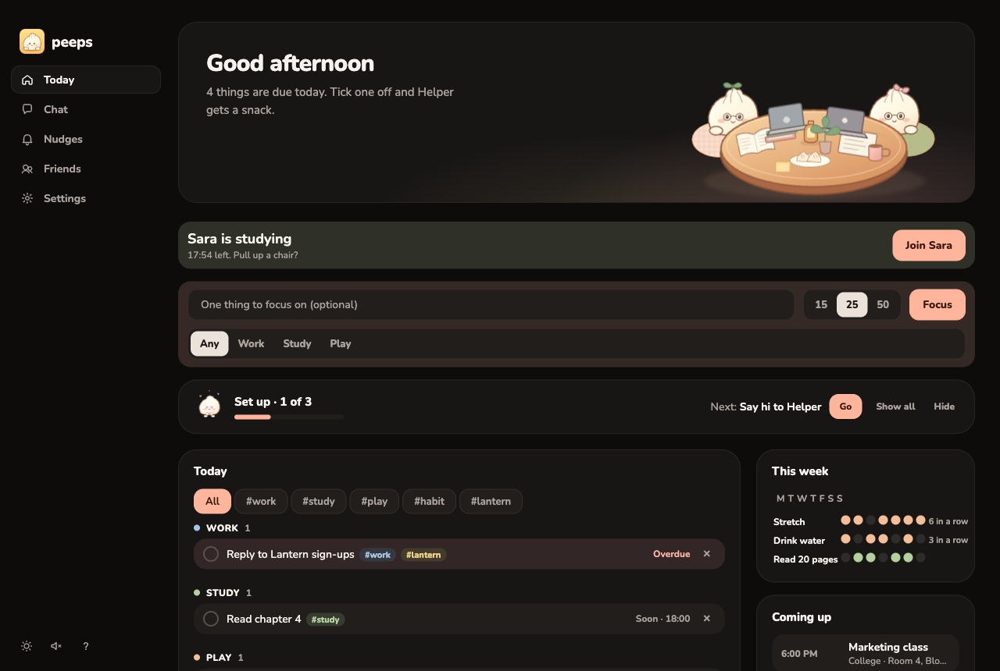

### Hi, I'm Mariyam

I make a lot of things. Some are software, some aren't, and most start with "it can't be that hard." I learn best by building, so every project is mostly an excuse to learn something I didn't know last month.

The software ends up here. I tend to make the tools I'd want open all day: small, more detailed than strictly necessary, no accounts and no tracking. Your stuff stays on your computer.

Lately I've been learning three.js, Rust, and how to explain to Windows that my app is fine, actually.

 

<table>
  <tr>
    <td width="50%" valign="top">
      
      <h3><a href="https://thesscarletskies.github.io/needledrop/">Needledrop</a></h3>
      A 3D turntable for your desktop. Whatever you play in Spotify, Apple Music, YouTube or your own files gets pressed onto a record, and the tonearm tracks across it as the song plays. Built entirely in code: no models, no images.
        
      <a href="https://thesscarletskies.github.io/needledrop/"><b>Download</b></a> · <a href="https://github.com/TheSscarletSkies/needledrop">Code</a>
       Mac · Windows · Linux &nbsp;·&nbsp; three.js · Electron
    </td>
    <td width="50%" valign="top">
      
      <h3><a href="https://github.com/TheSscarletSkies/peeps">peeps</a></h3>
      A little dumpling that lives at the top of your screen and keeps you on top of your day: to-dos, habits, focus timers, and nudges to stretch or drink water. You can chat with it, and send friends a poke or a tea break.
        
      <a href="https://github.com/TheSscarletSkies/peeps/releases/latest"><b>Download</b></a> · <a href="https://github.com/TheSscarletSkies/peeps">Code</a>
       Mac · Windows &nbsp;·&nbsp; Rust · Tauri · TypeScript
    </td>
  </tr>
</table>

More on the way. There's always more on the way.
